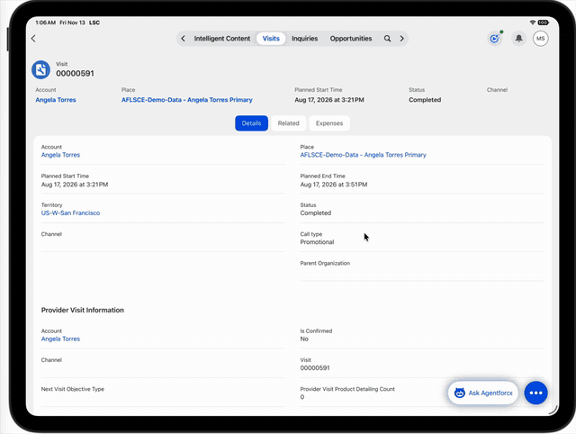

# Visit Custom Actions: Capture Expense and Capture Task

Two custom actions on the **Visit** screen of the Life Sciences Cloud iPad app that open a
pre-filled **Expense** or **Task** create form for the current Visit. This avoids sending reps
to related lists.



Tested on iPad against org `262-lsdo-july` (Summer '26 package 262), Visit record type `LSDO_PH_Visit`,
profile `LS PH Field Sales Representative`. Metadata API version 68.0.

## How it works

| Action | ActionType | ActionTarget | TargetParameters |
|---|---|---|---|
| Capture Task | URL | `lsc://deeplink/lightning/o/Task/new` | `WhatId={Visit.Id}` |
| Capture Expense | URL | `lsc://deeplink/lightning/o/Expense/new` | `ExpenseOriginId={Visit.Id}` |

Both are `LifeSciConfigRecord` records (category `CustomAction`), `EntityType` SObject, `EntityName` Visit,
`TargetType` External.

- `{Visit.Id}` is replaced at tap time with the Id of the Visit the action was launched from. The token must be the whole value of the parameter.
- The `QuickAction` field must match a Visit quick action that is listed in the Highlights Panel of the Visit Lightning page. That quick action makes the button appear. The custom action then takes over the tap.
- The app opens its own standard create form with the parameters pre-filled.

## Required pieces

1. **Visit quick actions** (`quickActions/Visit.lscMobileQuickAction_Capture*.quickAction-meta.xml`). They are listed on the Highlights Panel (`actionNames`) of the Visit flexipages assigned to the record type (`flexipages/Visit_LSDO_PH_FSR_KAM_FRM`, `Visit_LSDO_PH_MSL`). iPad builds Visit actions from the Highlights Panel of the page assigned to the record type, not from the object's quick actions.
2. **Custom actions** (`lifeSciConfigRecords/CustomAction_VisitCapture*`).
3. **Navigation tabs for Expense and Task.** This is required: a `.../o/<Object>/new` deeplink is rejected with `Missing.tab("expense")` unless the user has a tab for that object. Create two Tab records in Admin Console > Mobile > UI Settings (or `LifeSciConfigRecord` category Tab):
   - `NavTab_Expense`: tab name `standard-Expense`, assigned to the profile
   - `NavTab_Task`: tab name `standard-Task`, assigned to the profile

   These show up in the top nav bar for those users.
4. **Publish the mobile metadata cache** for the profile and sync the iPad. The `Status` shown by the generate tool is the parent record only. Check that the child `LifeSciMobileMetadataRecord` is **Active** and has a `MetadataDocumentId`.

## Deploy

```bash
sf project deploy start -o <alias> -d force-app
```

Then create the two navigation tabs (step 3), republish the cache (step 4), and sync.

## Pitfalls we hit

- **URL type with a `lightning://...` target opens the in-app External URL browser** (blank page). A URL custom action treats the target as a web address.
- **App type with no target** gives "action cannot be performed".
- **Custom actions cannot launch an LWC.** The earlier approach, an LWC quick action (`lwc/lscMobileQuickAction_Capture*`, `lightning__RecordAction` ScreenAction), opened the form directly when it was on the Account layout, but a custom action that matches its `QuickAction` name intercepts the tap. The LWCs are kept here as an alternative that needs no tabs, but are not used by the working setup. To use them, delete the two custom actions.
- Deeplink parameters are validated against the Task and Expense layouts on the device (field must be on the layout, editable). A rejected parameter rejects the whole link. For lookups, the Visit must be synced to the device.
- Cache publishing can end `Inactive` with no error text when the metadata service throttles (`REQUEST_LIMIT_EXCEEDED`). Wait and retry.
- The Visit Engagement floating menu is built from the Account layout and built-in items. It did not show these actions.

## Layout

```
force-app/main/default/
  lifeSciConfigRecords/   CustomAction_VisitCaptureExpense, CustomAction_VisitCaptureTask
  quickActions/           Visit.lscMobileQuickAction_CaptureExpense, ...CaptureTask
  flexipages/             Visit pages with the two actions on the Highlights Panel
  lwc/                    lscMobileQuickAction_CaptureExpense, ...CaptureTask (alternative path)
manifest/package.xml
```
